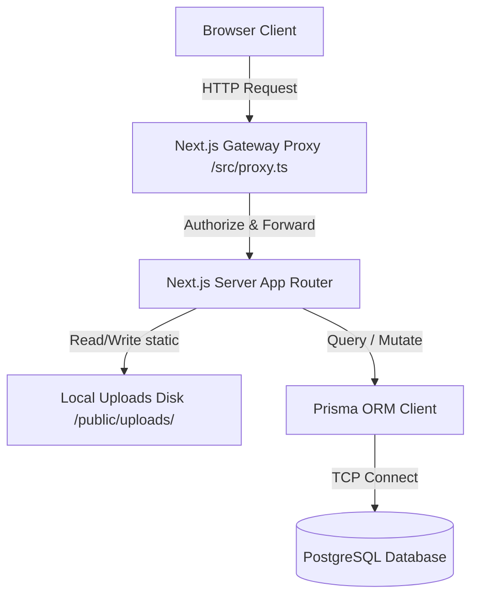
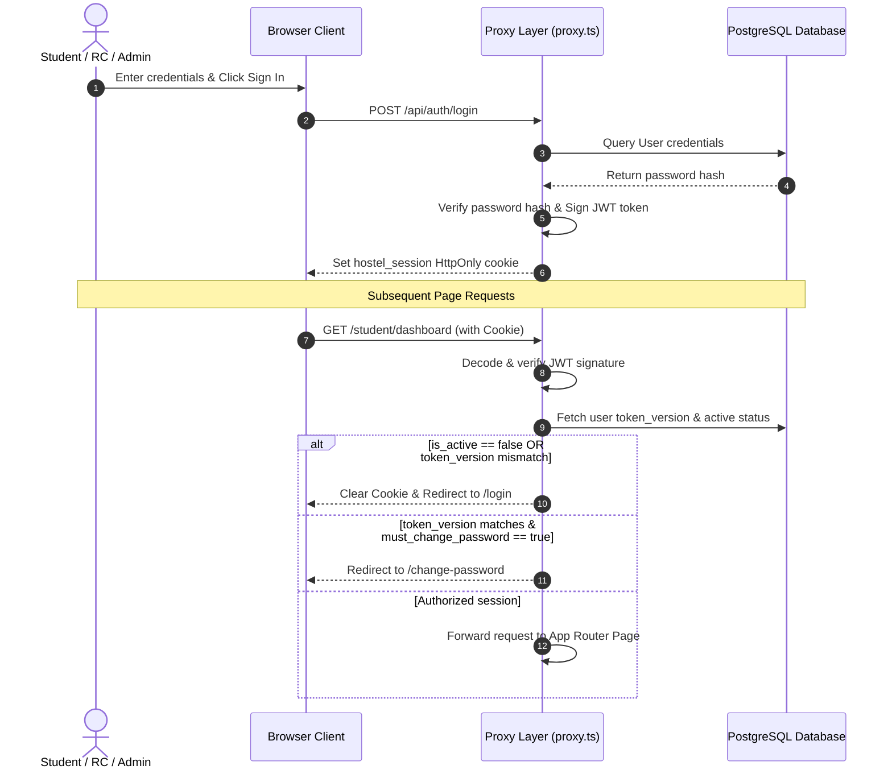

# System Architecture Guide

This document describes the structural design, directory layout, authentication flow, and authorization matrix of the ECH Mantharai Block Complaint Management System.

---

## 1. System Architecture

The application is built on a modern multi-tier architecture using Next.js, running the Server-Side App Router.

### Key Architectural Layers:
1.  **Gateway Proxy (`src/proxy.ts`)**: Intercepts incoming requests prior to routing. Evaluates JWT session cookies, handles role-based boundaries, checks deactivation status, and enforces mandatory password resets.
2.  **App Router Components**: Server components query database details directly using Prisma. Client components handle forms, pagination, status changes, and filter parameters.
3.  **Local Image Disk Storage**: Secure multipart uploads write images to `public/uploads/complaints/`, keeping database table footprints small by referencing them via relative file paths.
4.  **Data Access Layer**: Prisma client manages connection pools and parameterized queries to protect against SQL injections.

---

## 2. Authentication Flow

Authentication uses stateless JWT session tokens stored in secure, `httpOnly` cookies. The system invalidates tokens dynamically if database records update.

---

## 3. Role-Based Access Control (RBAC) Matrix

Access policies are enforced at both the UI routing level (via middleware) and the API handler level:

| Feature / Path | Public / Guest | Student | RC (Staff) | Admin |
| :--- | :---: | :---: | :---: | :---: |
| `/login` | **Allow** | Redirect | Redirect | Redirect |
| `/change-password` | Block | **Allow** (Enforced) | **Allow** (Enforced) | **Allow** (Enforced) |
| `/student/*` | Block | **Allow** | Block | Block |
| `/rc/*` | Block | Block | **Allow** | Block |
| `/admin/*` | Block | Block | Block | **Allow** |
| `/api/student/*` | Block | **Allow** | Block | Block |
| `/api/rc/*` | Block | Block | **Allow** | Block |
| `/api/admin/*` | Block | Block | Block | **Allow** |
| `Submit Complaints` | Block | **Allow** | Block | Block |
| `Acknowledge / Transition` | Block | Block | **Allow** | Block |
| `Confirm / Reject Fixes` | Block | **Allow** (Own) | Block | Block |
| `Verify & Close` | Block | Block | **Allow** | Block |
| `Excel Import Staging` | Block | Block | Block | **Allow** |
| `Audit Logs View` | Block | Block | Block | **Allow** |
