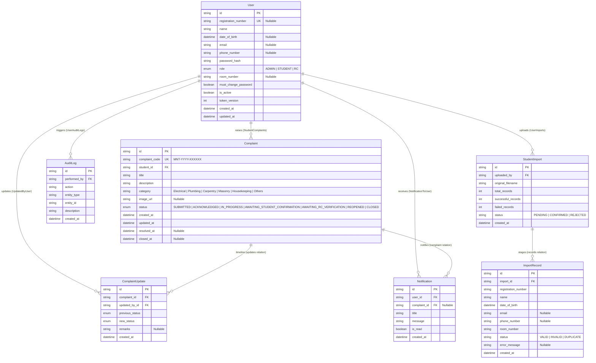

# Database Schema Guide

This document describes the database design, model properties, constraints, indexes, cascade delete boundaries, and relationships inside the PostgreSQL schema.

---

## 1. Entity Relationship (ER) Diagram

The relationships between database models are illustrated below:

---

## 2. Table Column Configurations & Constraints

### Users Table (`users`)
*   `registration_number`: Unique constraint (`@unique`). Nullable because administrators and RCs do not possess Anna University student registrations.
*   `date_of_birth`: Nullable. Required by application-level validation only during student creation.
*   `room_number`: Nullable. Required for students.
*   `is_active`: Defaults to `true`. Deactivation locks logins immediately.
*   `token_version`: Defaults to `0`. Incremented on password changes to invalidate active cookie JWTs.

### Complaints Table (`complaints`)
*   `complaint_code`: Unique constraint (`@unique`). Formatted as `MNT-[YEAR]-[6-DIGIT-SEQUENCE]` (e.g. `MNT-2026-000001`).
*   `status`: Defaults to `SUBMITTED`.
*   `resolved_at` / `closed_at`: Timestamp logs stored during work progression and official verification closure.

---

## 3. Indexes & Performance Tuning

Indexes are configured on all columns evaluated in filters, sorts, search operations, or joins:

*   **Users Table**:
    *   `@@index([registration_number])`
    *   `@@index([role])`
    *   `@@index([room_number])`
    *   `@@index([is_active])`
*   **Complaints Table**:
    *   `@@index([complaint_code])`
    *   `@@index([student_id])`
    *   `@@index([status])`
    *   `@@index([category])`
    *   `@@index([created_at])`
*   **Complaint Updates Table**:
    *   `@@index([complaint_id])`
*   **Notifications Table**:
    *   `@@index([user_id])`
    *   `@@index([is_read])`
*   **Audit Logs Table**:
    *   `@@index([performed_by])`
    *   `@@index([created_at])`

---

## 4. Delete Cascade Behaviors

Database relationships are protected by cascading boundary rules to maintain transactional safety:

*   **Restrict Deletion (`onDelete: Restrict`)**:
    *   `User` cannot be deleted if they are referenced by any existing `Complaint`, staged `StudentImport`, or `AuditLog`.
*   **Cascade Deletion (`onDelete: Cascade`)**:
    *   Deleting a `Complaint` automatically purges all connected `ComplaintUpdate` timeline traces.
    *   Deleting a `User` automatically purges all connected `Notification` records.
    *   Deleting a `StudentImport` log automatically deletes all raw staged sheet records in `ImportRecord`.
*   **Set Null Deletion (`onDelete: SetNull`)**:
    *   Deleting a `Complaint` preserves the `Notification` entry in the student's inbox but sets the relative `complaint_id` foreign key to `NULL`.
