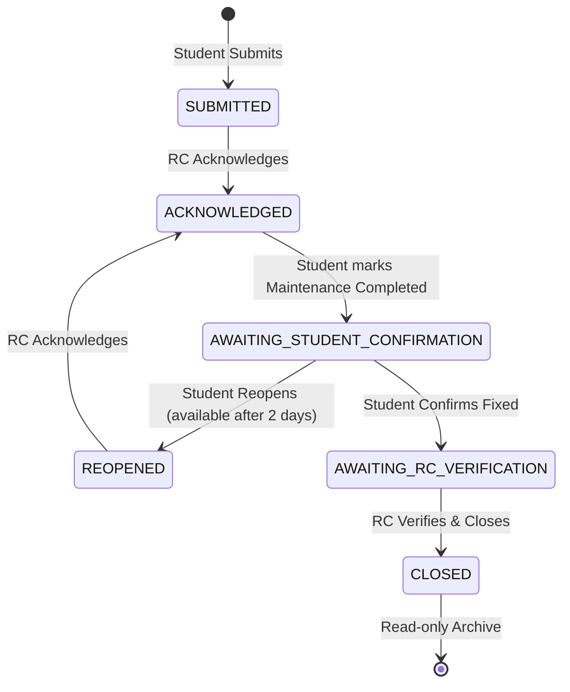

# ECH Hostel Complaint Management: Full Lifecycle Walkthrough

This walkthrough documents the features, design patterns, file changes, and validation results for the Engineering College Hostels (ECH) Mantharai Block complaint lifecycle, including the final approved business workflow and overdue complaint escalation policies.

---

## 1. Features Completed

### Student Dashboard & Submission
* **Student Dashboard**: Renders autofilled student details and metrics (Total Raised, Active, Awaiting Confirm, Closed, Reopened). Shows a list of recent submissions and notifications.
* **Multipart Image Uploads**: Supports raising complaints with an optional image upload (max 5MB, JPEG/PNG/WebP), saving securely to disk in `public/uploads/complaints/`.
* **Sequential Code Generator**: Optimistic database transaction concurrency retry loop generating unique codes like `MNT-2026-000001`.

### Student Directory & Details
* **My Complaints Page**: Displays a paginated history of the student's own complaints.
* **Search & Filters**: Supports pagination, multi-field search (Code, Title), and filters (Status, Category) synchronized with URL search parameters.
* **Details Page**: Displays comprehensive details, uploaded images, and a chronological history timeline of updates (newest first).
* **2-Day Reopen Locked Boundary**: Enforces that a student can only reopen a complaint after 2 days from the original creation date. Otherwise, the button is disabled and a helpful message is displayed.

### RC Dashboard & State Workflow
* **RC Dashboard & Layout**: Displays KPI metric counters (Total, Submitted, Acknowledged, Overdue, Awaiting Student, Awaiting RC, Reopened, Closed) and a system-wide complaints queue supporting full search, category/status filtering, and pagination.
* **Central State Machine**: Coordinates all database transitions (`ACKNOWLEDGE`, `STUDENT_MARK_COMPLETED`, `STUDENT_CONFIRM_FIXED`, `STUDENT_REOPEN`, `RC_VERIFY_CLOSE`) in a single atomic transaction.
* **Overdue Sweep Daemon**: Dynamically sweeps complaints that are unresolved for more than 3 days, marking them as `overdue = true` and escalating their priority to `HIGH`. On transition, it records exactly one timeline update, one RC notification, one Admin notification, and one AuditLog.
* **Verify & Close**: Allows the Residential Counselor to input final remarks and close resolved complaints, setting `closed_at` and `resolved_at` timestamps.

### Student Confirmation
* **Mark Completed**: Allows the student to transition an `ACKNOWLEDGED` complaint to `AWAITING_STUDENT_CONFIRMATION` once they observe maintenance staff has completed the physical repairs.
* **Confirm Fix / Reopen**: When a complaint status is `AWAITING_STUDENT_CONFIRMATION`, the student is presented with a verification box to mark it as **Confirm Fixed** (sent to RC for verification) or **Reopen Complaint** (reopening the issue back to RC Acknowledgment phase, available after 2 days), with optional remarks.

### Admin Dashboard & Escalations
* **Real-time Warning Banner**: Informs the Administrator of how many complaints are currently overdue (pending for >3 days).
* **Overdue Complaints List**: A dedicated table showing the details of all overdue complaints (Code, Student Name, Room Number, Category, Days Pending, Current Status, Priority).

---

## 2. Centralized State Machine Transitions

Below is a state diagram representing the centralized transition logic implemented inside [state-machine.ts](file:///c:/Users/acer/Downloads/project/Hostel/src/lib/state-machine.ts):

---

## 3. Main Files Created & Modified

### State Machine & APIs
* [state-machine.ts](file:///c:/Users/acer/Downloads/project/Hostel/src/lib/state-machine.ts): Houses the transition matrix, database transactional updates, dynamic overdue sweeps, notification generation, and audit logging.
* [student/complaints/[id]/transition/route.ts](file:///c:/Users/acer/Downloads/project/Hostel/src/app/api/student/complaints/%5Bid%5D/transition/route.ts): API for student actions (`STUDENT_MARK_COMPLETED`, `STUDENT_CONFIRM_FIXED`, `STUDENT_REOPEN`).
* [rc/complaints/[id]/transition/route.ts](file:///c:/Users/acer/Downloads/project/Hostel/src/app/api/rc/complaints/%5Bid%5D/transition/route.ts): API for RC actions (`ACKNOWLEDGE`, `RC_VERIFY_CLOSE`).
* [notifications/route.ts](file:///c:/Users/acer/Downloads/project/Hostel/src/app/api/notifications/route.ts): Endpoint for fetching, reading, and clearing notifications.

### Student Tracking Directory
* [student/complaints/page.tsx](file:///c:/Users/acer/Downloads/project/Hostel/src/app/student/complaints/page.tsx): Paginated server component list.
* [student/complaints/complaints-filter.tsx](file:///c:/Users/acer/Downloads/project/Hostel/src/app/student/complaints/complaints-filter.tsx): Handles state query parameters without deprecated `IN_PROGRESS`.
* [student/complaints/[id]/page.tsx](file:///c:/Users/acer/Downloads/project/Hostel/src/app/student/complaints/%5Bid%5D/page.tsx): Detailed history view.
* [student/complaints/[id]/confirmation-panel.tsx](file:///c:/Users/acer/Downloads/project/Hostel/src/app/student/complaints/%5Bid%5D/confirmation-panel.tsx): Handles "Mark Maintenance Completed", "Confirm Fixed", and "Reopen Complaint" with 2-day locking logic.

### Residential Counselor Portal
* [rc/layout.tsx](file:///c:/Users/acer/Downloads/project/Hostel/src/app/rc/layout.tsx) & [rc/sidebar.tsx](file:///c:/Users/acer/Downloads/project/Hostel/src/app/rc/sidebar.tsx): Layout structures.
* [rc/dashboard/page.tsx](file:///c:/Users/acer/Downloads/project/Hostel/src/app/rc/dashboard/page.tsx): Summary KPIs including Overdue count, dedicated Overdue Complaints list, and main queue sorting overdue items first.
* [rc/complaints/[id]/page.tsx](file:///c:/Users/acer/Downloads/project/Hostel/src/app/rc/complaints/%5Bid%5D/page.tsx) & [rc-actions-panel.tsx](file:///c:/Users/acer/Downloads/project/Hostel/src/app/rc/complaints/%5Bid%5D/rc-actions-panel.tsx): Detailed view and RC action triggers.
* [notification-dropdown.tsx](file:///c:/Users/acer/Downloads/project/Hostel/src/components/notification-dropdown.tsx) & [notifications-list.tsx](file:///c:/Users/acer/Downloads/project/Hostel/src/components/notifications-list.tsx): Dropdown bell and list views.

### Administrative Portal
* [admin/dashboard/page.tsx](file:///c:/Users/acer/Downloads/project/Hostel/src/app/admin/dashboard/page.tsx): Integrates overdue sweeps, alerts warning banner, and overdue complaints detail table.

---

## 5. LAN Wi-Fi Hosting & Diagnostics

This system is fully prepared for local network deployment on the hostel Wi-Fi, allowing multiple student devices to access the portal offline.

### Features Added
* **Dynamic allowedDevOrigins**: Updated [next.config.ts](file:///c:/Users/acer/Downloads/project/Hostel/next.config.ts) to dynamically retrieve active LAN IP interfaces using the Node `os` module, eliminating wildcards while allowing secure local dev HMR connections.
* **Binding to 0.0.0.0**: Configured `dev` and `start` scripts in `package.json` to bind the server to `0.0.0.0` by default.
* **Startup Diagnostics Hook**: Registered a server boot listener via [instrumentation.ts](file:///c:/Users/acer/Downloads/project/Hostel/src/instrumentation.ts) that executes [diagnostics.ts](file:///c:/Users/acer/Downloads/project/Hostel/src/lib/diagnostics.ts).
  * Validates: Database status, Prisma connectivity, environment variables, uploads folder availability, and WSL environments.
* **Offline Terminal QR Code**: Uses the `qrcode` library to render a high-contrast QR code in the terminal logs pointing directly to the LAN IP address.
* **LAN Utility Page**: Implemented a responsive LAN information page at `/lan` that displays status logs, connection steps, and a locally generated QR code for students to scan.
* **Firewall Guide**: Created a thorough guide [firewall.md](file:///c:/Users/acer/Downloads/project/Hostel/firewall.md) documenting Windows Defender Firewall rules and WSL 2 port-forwarding proxies (`netsh interface portproxy`).
